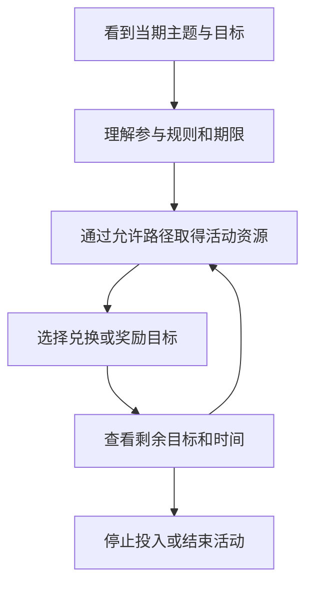
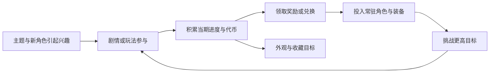

# 活动与商业化：让长期账户拥有当期目标

阴阳师 · 国服 App · 持续运营 / 内购

## 设计目的

活动改变玩家今天优先做什么，同时把角色、故事和奖励组织为一个有期限的目标。商业化则需要说明付费增加了什么，不能只罗列商城里有多少商品。

## 三类设计点

- **进度奖励与付费资格组合。** 2026 年十月花合战信息把等级达成和花札购买连接到外观奖励。它的关键是玩家能否提前判断自己的时间足够、购买后还缺什么条件。[官方当期信息](https://www.taptap.cn/app/12492/topic?page=4&type=official)

- **充值与身份展示连接。** 曜之阁活动将指定充值条件对应到场景与配套展示资源；从匹配到翻牌都能出现，扩大了展示机会。[官方说明](https://www.taptap.cn/moment/843879539892293296)

- **活动内资源与收集目标。** 10 月 14 日开启的萌神诞世记使用专门道具获取装扮等内容，说明活动会建立独立的资源入口与收集关系。具体抽取概率和成本本版未核实。[活动公告](https://www.taptap.cn/moment/858824843267672342)

## 玩家流程与节奏



付费应作为规则明确的可选路径展示，而非在每一步都默认发生。

## UI：先让人看懂，再让人决定

```ui-analysis
yy-liveops
```

- **时间拆开显示：** 活动参与、奖励领取、商店关闭分别注明。

- **奖励拆开显示：** 已获得、已达成未领取、需要进度、需要额外资格分别表达。

- **支付前说明剩余条件：** 避免玩家把购买资格误解成立即拿到全部奖励。

- **预告区别于开放：** 10 月 21 日糖果奇妙夜在本次研究日仍未开始，只能用于分析已公布的活动结构。[预告](https://www.taptap.cn/moment/859180565801207277)

## 一期活动如何接入常驻循环



这张图解释设计关系，不代表每一期活动都有全部环节。活动的价值在于改变一段时间内的目标；如果只是把同一个副本换一张皮，玩家感受到的可能只有额外任务。

## 商业化按出售的价值拆开

| 类型 | 实际出售的内容 | 与玩法的关系 | 需要检查的问题 |
|---|---|---|---|
| 获取资源 | 获得角色的机会或累积进度 | 接入召唤和收集 | 概率与保底是否独立、目标是否在池内 |
| 成长资源 | 缩短材料与时间积累 | 接入角色、御魂和体力 | 获得之后是否仍有其他瓶颈 |
| 花合战等进度奖励 | 在满足等级等条件后领取额外内容的资格 | 与周期参与相连 | 购买时能否算清剩余任务与可领取范围 |
| 角色或场景外观 | 展示效果、收藏与身份表达 | 接入人物、庭院或匹配场景 | 展示范围、重复获得与应用条件 |
| 高投入阶梯 | 累积消费对应的分层奖励 | 形成长期或阶段性目标 | 档位、期限与差额是否明确 |

花合战与曜之阁的存在分别见[当期官方信息](https://www.taptap.cn/app/12492/topic?page=4&type=official)与[曜之阁情报](https://www.taptap.cn/moment/843879539892293296)。该表拆解价值，没有在缺少商品页面时虚构人民币价格或性价比排名。

### 曜之阁：把外观放到高频社交场景

2026年9月官方情报提到八张星光契兑换斗技场景，并列出匹配名片、翻牌背景与音乐等展示。这类商品的观看对象不仅是自己，也包括与自己交互的人。[当期情报](https://www.taptap.cn/moment/843879539892293296)

我的判断是：相比藏在图鉴里的收藏，匹配和翻牌阶段能反复展示，辨识度更高；代价是华丽表现不能遮住禁用、选择与计时信息。充值对应星光契的具体金额未在已读正文中完整披露，不换算成售价。

## 时间、进度与领取分开管理

1. **预告期：** 说明开始时间与参与资格。未开放的活动不能显示可立即参加。

2. **参与期：** 玩家积累进度；可重复任务和一次性任务分开，日切以服务器时间为准。

3. **兑换期：** 参与可能已经结束，但仍能消费此前获得的代币；停止产出与停止消费是两个开关。

4. **结束期：** 处理未领资格、剩余代币与展示入口。继承、补发或清空必须明确，不能默认所有活动相同。

## 新手、回流与任务成就

- **新手任务负责串起系统。** 比起让玩家依次点击红点，更有用的是形成“获得角色→培养→配装→完成挑战”的因果。

- **回流任务负责找回目标。** 老玩家可能已有账号资产，缺的是版本理解；不应重新教授全部基础按钮。

- **成就负责沉淀长期记录。** 一次性里程碑与日常活跃应分开，避免重复完成的任务与永久达成状态混用。

官方[2018年回流活动](https://www.taptap.cn/moment/15217123987030075)按回归资格和绑定关系组织奖励；[2026新区公告](https://www.taptap.cn/moment/852285475547776231)强调追赶支持。本文分析组织方式，不将两期资格或奖励混成当前任务表。
## 我的评价

活动能把库存资源重新连接到目标，也会叠加日程与理解成本。应观察活动是否给玩家一个清楚的终点，以及不参与者能否继续原本的成长路线。没有同期参与、付费和留存数据，本版不以商业成绩为这些设计背书。

开发附录只覆盖任务进度、奖励领取和结束处理，不实现真实支付；价格、概率及完整活动经济需要另行取证。

[角色获取](../systems/召唤与角色获取.md) · [资源商店](../systems/资源与商店.md) · [角色叙事](../systems/角色叙事与外观.md)
