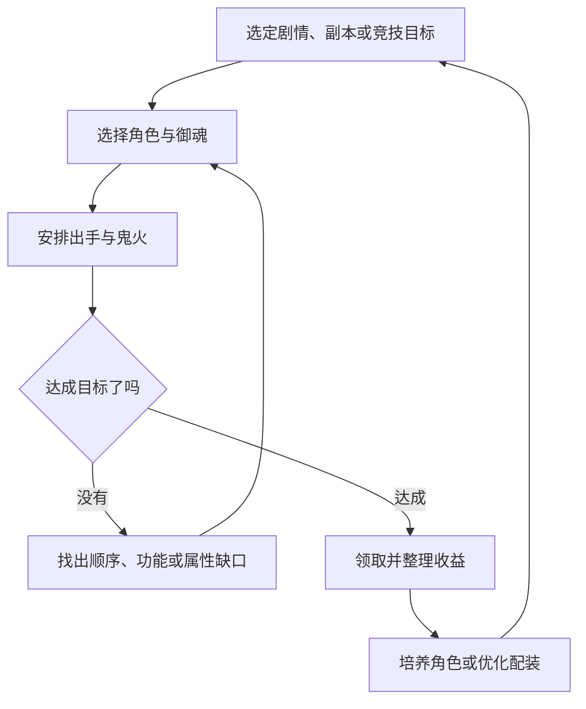
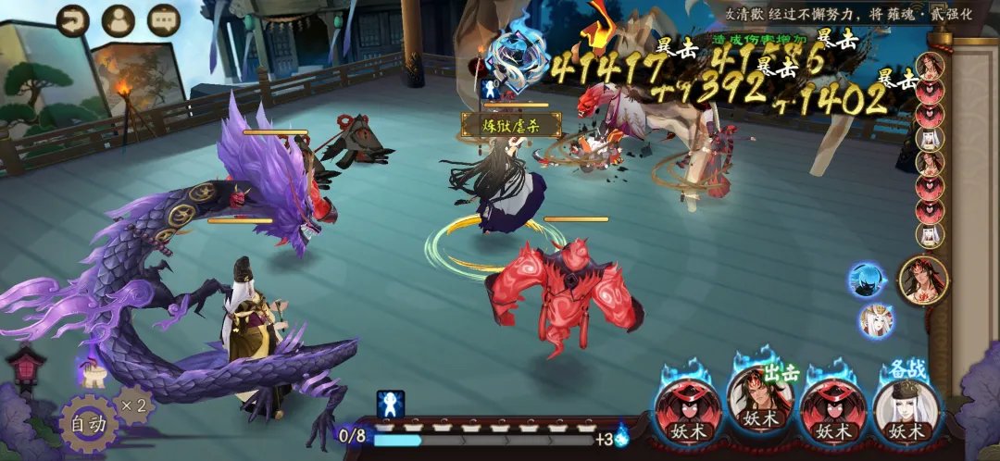
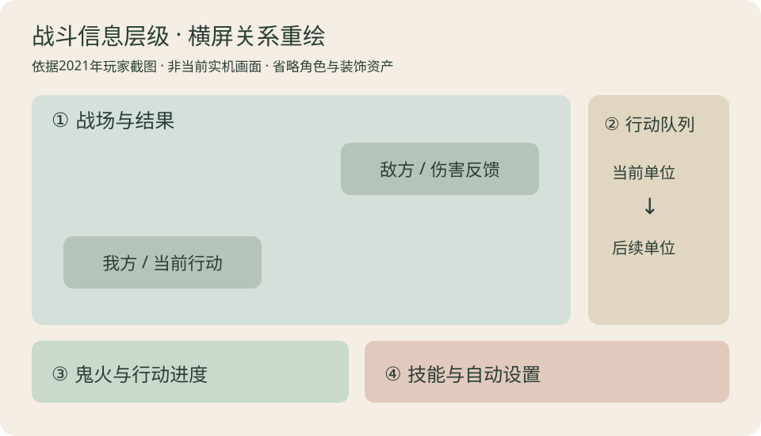
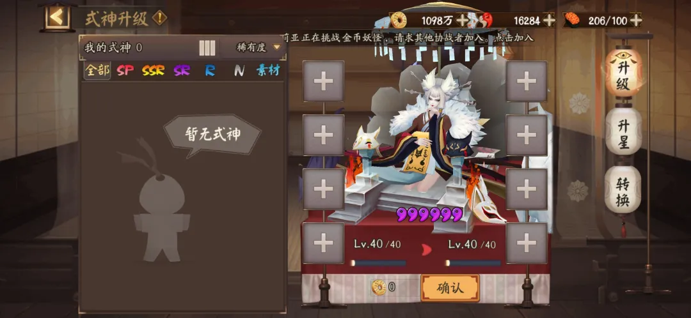

# 阴阳师：把一名式神，变成长期投入的理由

中国大陆 · Android / iOS App · 回合制角色养成 · 资料分析样稿 · 2026-10-17

**《阴阳师》的核心连接，是把“喜欢一个角色”转化成“为这个角色组织一支队伍”。** 召唤给出目标，养成让目标逐渐可用，御魂决定具体职责，副本与斗技再检验这套投入。角色收集和策略构筑因此共用一批资产，也共用一批矛盾：新式神带来新可能，同时会抬高理解和准备成本。

本篇分析国服手机 App。长期机制使用注明日期的历史资料；近期活动单独标明期限。判断来自资料与界面观察，未进行当前版本实机通关或付费测试。

## 01 产品与项目介绍

| 项目 | 范围 |
|---|---|
| 产品 / 厂商 | 阴阳师 / 网易游戏；TapTap 供应商登记为杭州网易雷火科技有限公司 |
| 平台与地区 | 中国大陆 Android、iOS；不含同 IP 衍生作，也不把海外服活动并入国服 |
| 上线 / 商店版本 | TapTap 登记上线 2016-09-08；Android 2.8.87（260928），更新于 2026-10-07 |
| 类型与经营 | 角色收集、队伍构筑、回合战斗；免费下载、应用内购买、持续运营 |
| 主要元素 | 式神、阴阳师、御魂、行动条、鬼火、妖怪故事、组队与竞技 |

以上来自 [TapTap 官方商店](https://www.taptap.cn/app/12492) 与 [中国区 App Store](https://apps.apple.com/cn/app/id895670960)。商店登记不等于当前服务器热更号。

### 玩家如何进行游戏

1. **先定目标。** 可能是推进剧情、取得资源、完善一套副本阵容，或应对斗技对手。

2. **组队与配装。** 按输出、供火、行动顺序、控制和生存等职责组织角色，再用御魂补足条件。

3. **战斗验证。** 观察技能是否按预期释放、关键单位是否先行动、队伍能否完成目标。

4. **整理与再投入。** 将收益投入式神、御魂或下次召唤；失败则回看是规则理解、配装、顺序还是成长缺口。

### 核心亮点

- **共享鬼火：把单个角色的强度变成团队预算。** 队伍需要安排谁先消耗、谁补给、谁保留行动机会。一名辅助的价值可能来自让主力按时出手，单看它自己的伤害会低估作用。战斗基础关系见[历史操作说明](https://www.taptap.cn/moment/15220000474270426)，本篇不沿用其中全部数值。

- **御魂构筑：同一角色有不同的使用条件。** 套装效果与属性组合让“拥有式神”和“拥有适合当前任务的式神”拉开距离。它能延长装备搜索的价值，也可能让玩家在大量掉落中难以识别真正的改善。历史[御魂分析](https://www.taptap.cn/moment/257945364034748643)展示了机制与场景之间的联系。

- **策略向外延伸：选择发生在战斗之前。** 养成对象、配速、御魂分配和竞技选人，都能改变同一套战斗的结果。代价是失败原因分散：玩家可能抄到了角色名单，却没有复制让它成立的条件。

- **角色内容与外观：让战斗资产拥有另一种价值。** 官方产品介绍同时强调人物故事、视觉、配音与音乐。我的判断是，这给非竞技目标留下空间：角色既能成为解题工具，也能成为收藏对象。外观是否影响属性必须逐项核实，不能由“皮肤”名称推断。

### 市面参考数据

| 渠道 / 访问日期 | 页面公开计数 | 可用来说明什么 |
|---|---|---|
| TapTap / 2026-10-17 | 7.4 分；59,500 条评价；约 1,450 万下载；约 526 万关注 | 该平台的历史触达与讨论规模，下载、关注为取整值 |
| 中国区 App Store / 2026-10-17 | 4.8 分；约 134 万个评分 | 另一商店的评价样本，不能与 TapTap 分数直接平均 |

数据链接见上方两家商店。它们不能换算成当前活跃、全平台销量或收入；不同渠道用户、评价尺度和累积时间并不一致。本版没有可靠的同期流水或留存数据。

## 02 核心循环：从打赢一次，到稳定完成



这张图表达分析关系：战斗结果需要能回到具体调整，循环才不只是重复领取奖励。

- **局内循环：** 看行动顺序和场面，选择目标与技能，消耗或获得鬼火，再观察局面。自动战斗把部分即时操作转移到战前配置与技能设置；稳定性因此成为设计重点。

- **单次目标循环：** 准备一队，尝试关卡，调整薄弱环节，形成可靠方案。首次通过和稳定重复并不是同一个目标：后者还会关注时间、波动和操作次数。

- **跨日循环：** 将日常、活动与社交产出投入长期目标，再为新角色或新玩法补充方案。活动能改变今天的优先事项，但不能让所有常驻路线失去意义。

## 03 游戏节奏：三个阶段解决不同问题

| 阶段 | 玩家核心问题 | 主要内容 | 设计风险 |
|---|---|---|---|
| 前期：建立第一支可用队伍 | 为什么有角色却打不动 | 角色职责、供火、基础御魂、剧情与入门资源 | 系统过早堆叠；照抄阵容仍不懂顺序 |
| 中期：形成稳定资源路线 | 怎样更稳定、更省操作地取得所需材料 | 副本队伍、装备筛选、技能节点、多目标资源分配 | 大量掉落变成整理劳动；养成分散 |
| 后期：自选专精目标 | 还愿意为哪种改善继续投入 | 斗技对局、特定挑战、角色与外观收藏、版本活动 | 新内容变成强制补课；重复日常挤压体验 |

- 这些阶段按能力与目标划分，不对应固定天数。新区、回流和老账号的起点不同，不能共用一条“七天成型”进度表。

- [2026 年新区公告](https://www.taptap.cn/moment/852285475547776231)提供角色获取和挑战效率方面的福利。它说明官方在处理新玩家追赶成本，不能证明新玩家已经学会配队，也不能代表所有老区常驻收益。

## 04 商业化：角色、效率与表达分别出售什么

- **角色与培养资源：** 获取目标角色后还存在配置与培养需求。付费价值应拆成获得机会、缩短积累、补足可用条件，不能把抽卡次数直接当成强度。当前召唤细则须按卡池核实，本文不套一个通用保底。

- **进度型外观奖励：** 2026 年十月花合战公告将等级条件与花札购买组合起来。它出售的既有奖励资格，也有在活动周期内完成进度的理由。对设计者而言，应关注晚加入者是否能判断自己来不来得及，而不是只看奖励展示。[当期官方信息](https://www.taptap.cn/app/12492/topic?page=4&type=official)

- **高投入表达：** 2026 年曜之阁活动把充值条件连接到场景、名片、翻牌背景与配乐等展示。其价值不只发生在菜单，也延伸到玩家反复经历的匹配和对局过程。[官方情报](https://www.taptap.cn/moment/843879539892293296)

- **限时活动组织资源：** 活动规则需要分别展示参与时间、兑换时间和资源用途。已公布但尚未开始的活动仍属预告，例如 10 月 21 日开启的糖果奇妙夜；不能写成访问当天已可体验。[活动预告](https://www.taptap.cn/moment/859180565801207277)

这里属于持续运营与内购分析，不按买断本体／DLC结构解读。完整礼包清单、价格效率和真实付费转化不在已取证范围。

## 05 系统地图：点击进入独立设计分析

```system-map
onmyoji-cn-app
```

地图按功能组织十组系统；剧情探索、御魂副本、觉醒、秘闻与首领挑战归入 PVE，结界、师徒和阴阳寮归入社交。每组解释目的、功能、UI与取舍，重点战斗、御魂和养成有专门图解。百鬼棋等扩展玩法、完整成就与当前设置仍待专项采证，这不是对当前全部菜单的实机枚举。

## 06 数值框架：深度来自条件的连接

| 层次 | 主要内容 | 决策重点 |
|---|---|---|
| 角色底座 | 等级、星级、技能，以及适用角色的觉醒 | 先补功能节点，还是继续提高面板 |
| 装备构筑 | 御魂位置、主副属性、强化与套装效果 | 单件改善是否破坏整体速度或套装条件 |
| 队伍关系 | 行动顺序、鬼火、增益、控制与生存 | 单人收益是否挤占团队资源 |
| 挑战环境 | 敌方机制、玩法限制与对手选择 | 同一属性为何在不同模式价值不同 |
| 长期供给 | 体力、金币、召唤资源、材料与活动兑换 | 把投入送到当前真正的瓶颈 |

历史机制资料见[入门攻略](https://www.taptap.cn/moment/15210316736497577)与[首领御魂更新](https://www.taptap.cn/moment/15217123987030075)，具体成本和数值上限不据此宣称为当前配置。

- **纵向深度是能力达标。** 例如一个角色能活到出手，或关键技能达到可用节点。其收益可能跨过阈值，不能一概写成线性成长。

- **横向深度是有替代方案。** 更多角色和御魂能够应对不同限制，但“选项更多”只有在多个选项确实有用途时才成立。

- **整体约束比总分重要。** 一个输出配装数值更高，却改变了必要的出手关系，可能使整队表现下降。御魂工具应说明满足了哪些条件，而非只展示一个综合评分。

**自设算例：** 一队需要辅助先行动，参考条件设为辅助速度大于输出速度。辅助 130、输出 125 时成立；把输出提升到 135 后条件失效。数字用于说明“局部提升可能破坏整体条件”，不是原作某阵容的推荐配速。

## 07 美术与 UI：角色展示和战场阅读分工



来源：[鸭梨的历史界面记录，2021](https://www.taptap.cn/moment/15220000474270426)。这是历史原图；下方示意图只提炼信息关系。



- **横屏战场把角色关系展开。** 历史战斗截图中，场地占据主体；行动队列贴近右侧，技能状态和鬼火靠近底部。它把“现在发生什么”和“下一步能做什么”分在不同区域。来源：[鸭梨的战斗截图](https://www.taptap.cn/moment/15220000474270426)。

- **高亮反馈有收益，也有竞争。** 截图里多组黄色伤害字叠在敌方区域，攻击结果容易被注意到；同时会遮住模型与局部状态。这个画面支持拥挤风险的判断，不能由单帧断言整场战斗始终难读。

- **角色展示保留情感价值。** 养成截图中，角色位于主体展示区域，材料列表、成长方式和确认入口围绕它组织。玩家调整数值时仍能看到对象，培养不会完全变成一张表。该布局观察限于历史样本，不当作当前 UI 复刻。



[养成详细页](../systems/式神与阴阳师养成.md)分别展开式神和阴阳师的成长，并列出材料表、参考经验曲线、消耗公式与可下载配置；[战斗详细页](../systems/行动条与鬼火战斗.md)把鬼火和行动条截成局部小图，放在对应说明旁边。

- **视觉风格要服务两种距离。** 展示页允许读服饰和人物细节，战斗中则需要快速区分单位、阵营与状态。若只增加展示精度，却没有维持小尺寸轮廓和反馈层级，角色越丰富，战场越可能难读。

## 08 海内外与版本边界

官方有[日本服攻略入口](https://www.onmyojigame.jp/strategy/novice/index.html)和[繁体中文版本公告](https://www.onmyojigame.com/zh/news/official/2020/03/18/25278_869851.html)。本篇只据此确认存在不同语言运营入口，没有把其活动、价格、概率或内容进度用于国服分析。

后续跨区对照应选同一系统，分别记录区服、采样日期、卡池范围、币种价格、活动周期与文字布局，再讨论设计差异。单凭作品采用日本妖怪题材，不能推断它在日本市场的实际表现。

## 09 我的评价与下一步验证

- **值得借鉴：** 角色魅力、队伍职责与装备条件相互支持，让一份角色资产同时承载收藏和策略目标。迁移时应先验证少量角色能否形成多种有用关系，再扩大数量。

- **最需要控制：** 获得角色之后的可用成本。若技能、装备、配速与环境知识同时缺失，获得的兴奋很容易转为搁置。更好的培养引导应指向一个可完成的使用场景。

- **优先实测：** 新账号首次形成稳定资源队的路径；一次完整日常中的有效决策和重复操作；一批御魂从掉落到保留的筛选过程。没有这些记录，本篇不评估真实日耗时、毕业周期或留存效果。

首版适合验收拆解结构、图文解释和系统链接。所有演示行为只属于标明范围的补充设计。
