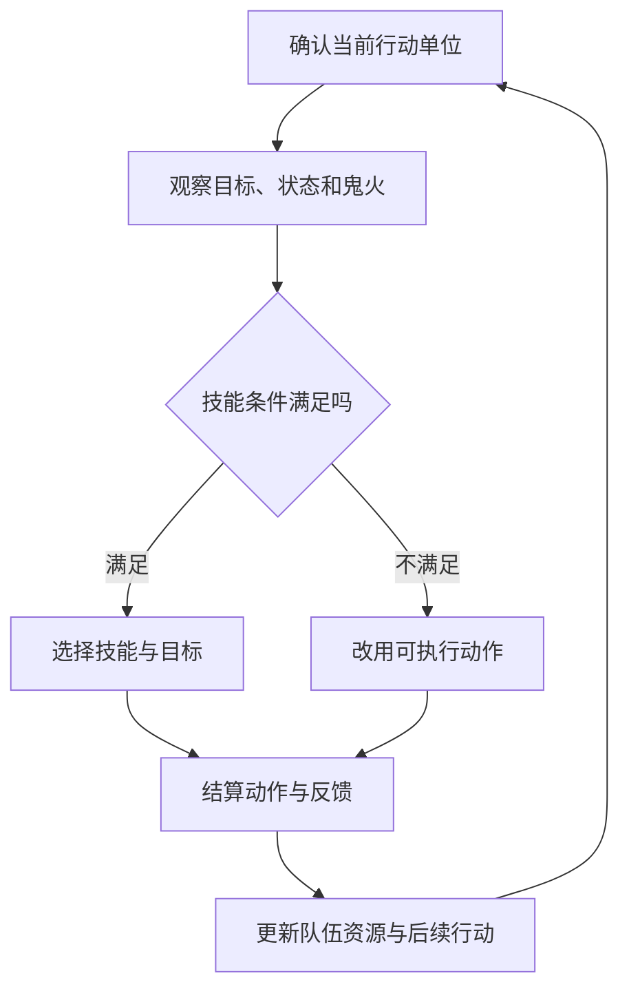

# 行动条与鬼火：团队要按顺序兑现能力

阴阳师 · 国服 App · 核心玩法 / 战斗

## 设计目的与边界

战斗让队伍配置转化为可观察的结果。它最有价值的问题不是“哪个技能伤害最大”，而是**谁先行动、消耗什么、给下一个角色留下什么条件**。本文讨论基础关系，不复原所有式神技能、优先级与结算算法。

## 系统功能

- **行动安排：** 速度与行动条变化影响出手，玩家由此组织先手、增益和输出的顺序。

- **团队预算：** 鬼火把多个角色的技能连接起来；一个角色提前耗火，可能改变后续角色的选择。

- **执行设置：** 手动与自动选择让玩家在即时操作和战前安排之间分配注意力。历史攻略记录了自动技能选择入口，不代表所有模式执行逻辑相同。[战斗操作样本，2021](https://www.taptap.cn/moment/15220000474270426)

## 玩家流程与设计解释



图解描述决策结构，不是原作底层结算顺序。反击、追加回合等特例需专项核对。

- **供火和输出需要一起评价。** 我会观察关键输出行动时是否具备条件，而非只统计一场战斗总共获得多少鬼火。供给时间不匹配，资源总量够也可能无法执行计划。

- **稳定与极限伤害有不同价值。** 对重复资源副本，减少一次失误可能比提高单次峰值更重要；对竞技，则还需要给对手动作留下应对空间。

## UI：把下一步决策放在可读位置

```ui-analysis
yy-combat
```

1. **战场区域：** 表达目标、血量与动作结果。伤害数字、状态图标与角色特效应有优先级，不能同时争夺全部注意力。

2. **右侧队列：** 帮助玩家预判接下来谁行动。变化应能被识别，否则配速调整缺少反馈。

3. **底部资源：** 把团队预算放在操作附近。不足时需要说明缺少什么，而非让操作无响应。

4. **技能与自动设置：** 明确当前采用的执行方式。历史截图来自上方攻略；重绘仅保留信息关系。

## 数值框架与取舍

- 攻击、暴击等影响结果规模；速度影响时机；控制和抗性影响对方能否兑现能力。它们的价值由具体队伍与环境共同决定，不能汇总成脱离场景的战力结论。

- 迁移到新项目时，先用少量角色验证“调整顺序能改变结果”，再加入更多触发。否则状态多了，玩家却难以解释成败。

## 关联与待核实

[御魂构筑](../systems/御魂构筑与整理.md)改变属性和触发条件；[式神养成](../systems/式神与阴阳师养成.md)提供能力；[斗技](../systems/斗技与阵容应对.md)引入对手选择。当前全部技能优先级、自动目标策略和异常交互未核实。
