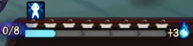
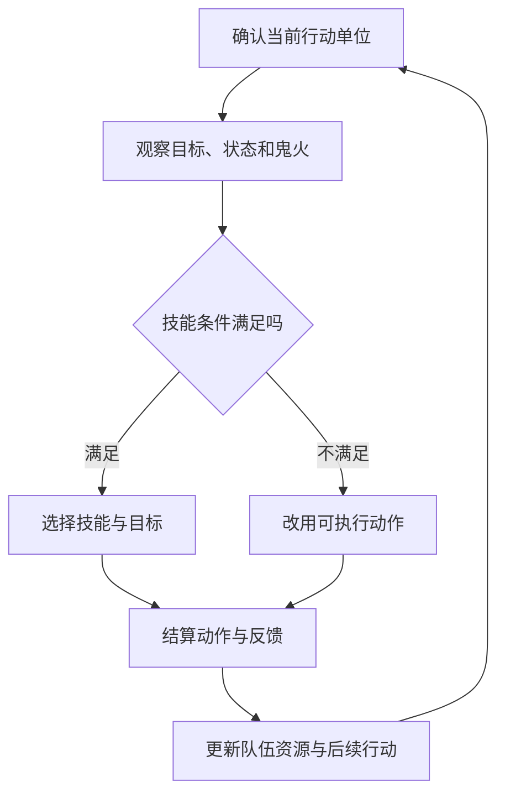

# 行动条与鬼火：团队要按顺序兑现能力

阴阳师 · 国服 App · 核心玩法 / 战斗

## 设计目的与边界

战斗让队伍配置转化为可观察的结果。它最有价值的问题不是“哪个技能伤害最大”，而是**谁先行动、消耗什么、给下一个角色留下什么条件**。本文讨论基础关系，不复原所有式神技能、优先级与结算算法。

## 系统功能


来源：[鸭梨的历史战斗截图，2021-12-31修订](https://www.taptap.cn/moment/15220000474270426)。下面把需要辨认的小区域单独放大，避免读者在整张图中找术语。

### 鬼火：全队共用的技能预算



· **先读当前值。** 图中“0/8”表示这张截图里的当前鬼火为0、显示上限为8；不是每名式神各有8点。这个局部图不能证明所有模式、特殊技能或版本的上限都相同。

· **再读补给时机。** 中部推进条与右侧“+3”让玩家区分“现在能花多少”和“接下来会补多少”。静态截图可以支持界面含义，不能单独验证每个动作如何推进、何时结算。

· **把资源放回决策。** 举例：当前有3点火，辅助和输出各需3点，辅助先用后输出就可能无法释放技能。这是解释共享预算的算例，不是在复述图中这一次战斗。

### 行动条：谁先用这份预算


右侧头像队列与底部鬼火必须合起来读：不仅看资源够不够，还要看谁先行动。速度、拉条和特殊插队会改变顺序；头像的上下关系不能代替完整的行动条结算公式。

### 三项相互关联的功能

- **行动安排：** 速度与行动条变化影响出手，玩家由此组织先手、增益和输出的顺序。

- **团队预算：** 鬼火把多个角色的技能连接起来；一个角色提前耗火，可能改变后续角色的选择。

- **执行设置：** 手动与自动选择让玩家在即时操作和战前安排之间分配注意力。历史攻略记录了自动技能选择入口，不代表所有模式执行逻辑相同。[战斗操作样本，2021](https://www.taptap.cn/moment/15220000474270426)

## 玩家流程与设计解释



图解描述决策结构，不是原作底层结算顺序。反击、追加回合等特例需专项核对。

- **供火和输出需要一起评价。** 我会观察关键输出行动时是否具备条件，而非只统计一场战斗总共获得多少鬼火。供给时间不匹配，资源总量够也可能无法执行计划。

- **稳定与极限伤害有不同价值。** 对重复资源副本，减少一次失误可能比提高单次峰值更重要；对竞技，则还需要给对手动作留下应对空间。

## UI：把下一步决策放在可读位置

```ui-analysis
yy-combat
```

1. **战场区域：** 表达目标、血量与动作结果。伤害数字、状态图标与角色特效应有优先级，不能同时争夺全部注意力。

2. **右侧队列：** 帮助玩家预判接下来谁行动。变化应能被识别，否则配速调整缺少反馈。

3. **底部资源：** 把团队预算放在操作附近。不足时需要说明缺少什么，而非让操作无响应。

4. **技能与自动设置：** 明确当前采用的执行方式。历史截图来自上方攻略；重绘仅保留信息关系。

## 数值框架与取舍

- 攻击、暴击等影响结果规模；速度影响时机；控制和抗性影响对方能否兑现能力。它们的价值由具体队伍与环境共同决定，不能汇总成脱离场景的战力结论。

- 迁移到新项目时，先用少量角色验证“调整顺序能改变结果”，再加入更多触发。否则状态多了，玩家却难以解释成败。

## 阵容配置：把角色名单变成执行方案

一套阵容至少有三层：谁上场、携带什么、按什么顺序执行。只分享角色头像，会丢掉最容易导致失败的后两层。下面是对配队过程的设计整理，具体人数和可选角色由玩法规则决定。

| 配置层 | 玩家需要确认 | 典型失败 | 界面应提供的反馈 |
|---|---|---|---|
| 职责 | 输出、供火、生存、增益、控制是否覆盖目标需求 | 五名角色都强，却没人保证关键技能可用 | 按职责查看成员，缺项提示不强制推荐固定阵容 |
| 属性 | 速度顺序、暴击条件、生存门槛 | 输出先于增益行动 | 对比整队面板，标出前后顺序变化 |
| 技能 | 手动 / 自动、指定技能、指定目标 | 自动普攻或技能打错对象 | 将自动策略和技能锁定显示为独立状态 |
| 环境 | 副本机制、禁用规则、敌人阶段 | 常用队进入另一个玩法失效 | 入场前显示玩法限制，保留原方案供比较 |
| 复用 | 角色与御魂是否被其他方案引用 | 调整一套队伍影响另一套 | 应用前列出关联方案；这是补充交互建议 |

### 一次行动要读哪些信息

1. **轮到谁。** 行动角色、技能禁用状态和控制效果决定可选动作。

2. **能做什么。** 检查共享鬼火、技能冷却、目标存活和目标类型；资源不足与目标不合法是两种错误。

3. **先解决什么。** 优先救人、保留鬼火、解除限制还是输出，需要结合下一名行动者判断。

4. **发生了什么。** 区分未命中、被抵抗、被护盾吸收、伤害免疫与目标死亡。反馈相同，玩家就无法修正计划。

5. **下一步有什么变化。** 更新行动条、鬼火和持续状态，避免表现还在播放时让玩家误读旧数值。

### 自动战斗解决重复，也会隐藏失败原因

- **第一次打通看决策空间。** 玩家需要理解技能与目标，自动功能不能替代教学。

- **稳定刷取看执行一致性。** 调整御魂后是否仍按原顺序出手，比单次最高伤害更有意义。

- **复盘看首个偏离点。** 我更希望战报显示“第几次行动开始缺火 / 顺序改变”，而不是只给伤害排行榜。此项是迁移建议，未宣称原作已有这种战报。

## 参考战斗的完整结算范围

开发附录补齐行动条推进、同速排序、共享资源、技能、状态、自动目标和终局。它定义一套可实现的基础回合战斗；原作全部式神技能、御魂触发和隐藏优先级需要逐项采证，不由基础模型推断。

## 关联与待核实

[御魂构筑](../systems/御魂构筑与整理.md)改变属性和触发条件；[式神养成](../systems/式神与阴阳师养成.md)提供能力；[斗技](../systems/斗技与阵容应对.md)引入对手选择。当前全部技能优先级、自动目标策略和异常交互未核实。
