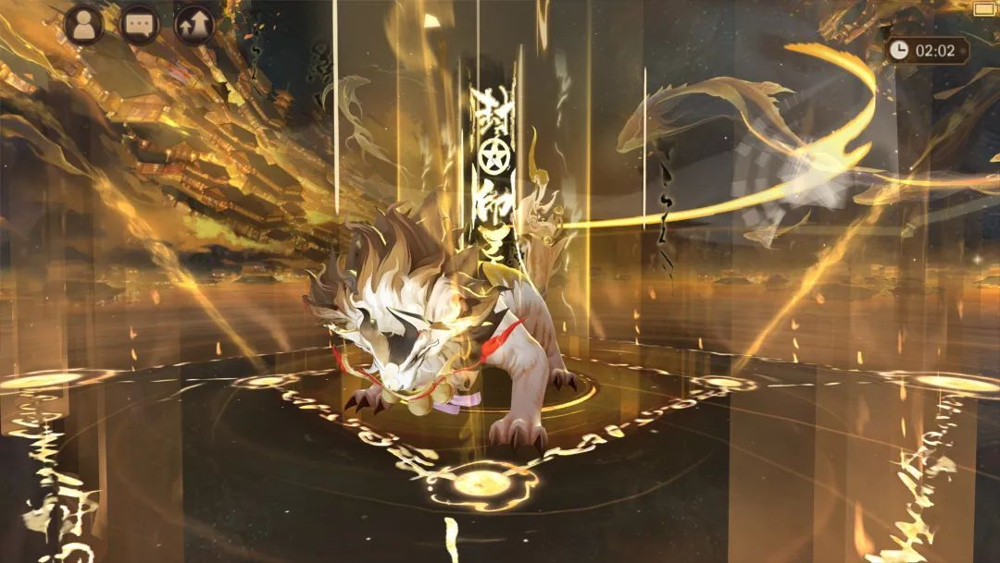

# 角色叙事与外观：让队伍成员成为被记住的人

阴阳师 · 国服 App · 内容表达 / 收藏

## 设计目的

角色需要在战斗之外建立可辨识的形象。故事、造型、声音和展示空间能让玩家对同一个角色产生多种目标：了解它、使用它、收藏相关内容，或向其他玩家表达偏好。

## 系统功能

- **故事与人物关系：** 官方介绍将式神故事作为产品组成部分。它能解释人物动机和关系，为获取与培养提供战斗以外的理由。[官方产品介绍](https://apps.apple.com/cn/app/id895670960)

- **角色展示与培养衔接：** 历史养成截图保留较大的角色展示区域，培养操作围绕人物组织。这样的布局让数值操作始终有明确对象。[界面样本](https://www.taptap.cn/moment/15220000474270426)

- **外观与公共展示：** 外观内容还可以出现在场景、名片、翻牌和声音中。不同展示位置的价值取决于被看到的频率和对象，不能把所有外观当成同一种商品。[场景外观说明](https://www.taptap.cn/moment/843879539892293296)

## 美术观察与设计判断

- **形状：** 历史战斗截图的角色用明显的体型与轮廓区分；大体型单位也会占用更多屏幕，增加遮挡风险。缩小后能否认出职责，比展示页细节更重要。

- **色彩：** 战场地面相对平整，角色、血条和高亮伤害字成为主要信息。多种高亮同时出现时，需要区分当前动作与背景反馈。

- **材质与布局：** 养成画面中的纸张、木质边框和纵向标签共同保持世界观气质。装饰应帮助分区，不能使消耗、确认与返回难以辨认。

- **动态证据边界：** 本轮读图是静态历史样本，没有连续片段来判断命中停顿、镜头运动或配音节奏，不把官方宣传文案转成实测评价。

## UI 与收藏功能的参考设计

```ui-analysis
yy-story
```

1. 从角色或事件入口查看故事，说明前置条件和进度。

2. 阅读或观看后保留可回顾入口；中途退出能恢复位置。

3. 外观预览明确展示适用角色、出现位置及获取条件。

4. 应用后能够恢复原设置。以上是参考流程，当前原作每个入口的保存行为尚未核实。

## 取舍与适用

角色内容适合支撑长期收藏，但不应要求玩家读完全部故事才能理解技能。战斗规则需要独立清楚，叙事负责让这份选择更有意义。迁移时先用少数角色验证“读过故事后，玩家是否更愿意使用或记住它”，不要以大量文字代替人物关系。

[式神养成](../systems/式神与阴阳师养成.md) · [活动商业化](../systems/活动与商业化.md)


## 一名角色的内容不止战斗卡面

| 内容层 | 玩家接触点 | 设计用途 | 与战斗的连接 |
|---|---|---|---|
| 世界与主线 | 章节、事件、场景 | 解释行动动机与人物关系 | 为探索和挑战提供语境 |
| 角色叙事 | 传记、剧情片段、语音 | 让同类职责的角色仍有个性 | 使收集目标不只由强度决定 |
| 表演与视听 | 模型、动作、配音、音乐 | 建立识别度和情绪节奏 | 技能表现同时承担结果反馈 |
| 外观与展示 | 皮肤、庭院、头像框等 | 长期收藏和自我表达 | 使用场景与战斗可读性需要兼容 |

产品的角色、剧情与视听定位来自[官方商店介绍](https://www.taptap.cn/app/12492)。具体角色传记条件、皮肤属性、语音数量与资源规格需逐项采证；本页不将“外观”自动等同于完全无数值影响。

## 从内容入口到长期回看

1. **遇见角色。** 主线、活动、召唤和图鉴给出不同的初次接触点。

2. **产生问题。** 人物关系、动机或能力让玩家愿意继续看，而不只是点击跳过领奖。

3. **解锁内容。** 条件应显示可执行目标；与养成相连时，要避免用模糊进度阻碍阅读。

4. **完成与回看。** 剧情奖励只能发一次，章节与已解锁内容应允许再次观看。

5. **表达偏好。** 将已有外观应用到角色或场景；预览与拥有资格是两种状态。

## 美术表现：展示和战斗分别解决什么



- **主体识别：** 图中契灵位于画面中央，体型、面部和红色饰物构成视觉重点；金色环形特效围绕主体组织。这是对2023年宣传画面的观察。

- **空间与动势：** 竖向光束、环绕轨迹与前景符文共同强调技能正在发动。静帧不能证明实际动画时长和战斗节奏。

- **信息竞争：** 当角色、场景和特效都使用高亮金色时，关键目标和状态需要另有层级。设计上应分别检查单人展示与多人混战，不能只验收宣传镜头。

### 参考美术交付清单

| 类别 | 交付内容 | 验收重点 |
|---|---|---|
| 角色 | 正侧背视图、模型、材质、基础动作 | 小尺寸轮廓、阵营辨认、与地面接触 |
| 技能 | 起手、命中、持续、消失四段表现 | 结果时间点与逻辑事件一致，低特效档仍可读 |
| UI | 头像、技能图标、状态、品质与锁定标识 | 同时具备文字或形态提示，不只依靠颜色 |
| 叙事 | 分镜、字幕、语音、回看与跳过 | 字幕不遮关键动作，跳过不漏奖励结算 |
| 外观 | 预览、拥有、应用前后与不适用状态 | 不替换未拥有资源；预览退出恢复原状态 |

该清单是复现项目的建议交付物，未宣称获得原作美术规范或源文件。

## 我的取舍

我会保留角色在养成、战斗和叙事中的连续形象，让数值投入始终对应一个具体对象。更难的是控制内容规模：角色越多，技能表现、剧情入口、旧内容回看与外观适配的维护成本越高。新项目应先验证少量角色能否建立关系和记忆，再扩充数量。
