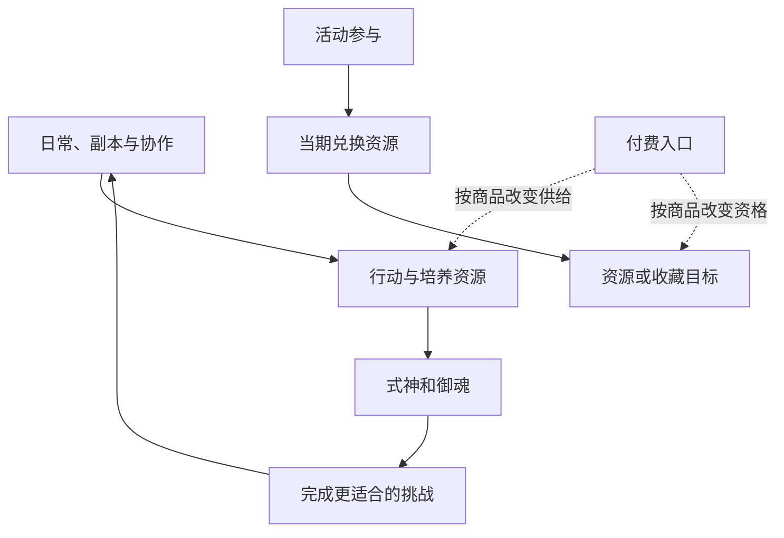

# 资源与商店：把今天的行动连接到长期目标

阴阳师 · 国服 App · 经济 / 资源分配

## 设计目的

资源系统决定玩家在多个成长目标之间如何选择。货币种类多不等于经济深；真正需要分析的是每种资源的来源、可替代性、消耗对象和时间限制。

## 资源框架

| 资源角色 | 例子 | 主要判断 |
|---|---|---|
| 行动预算 | 体力与特定玩法门票 | 今天参与什么，能否转移到别的目标 |
| 培养投入 | 金币、经验与各类材料 | 当前瓶颈在哪，培养谁 |
| 获取机会 | 勾玉、召唤符咒 | 现在使用还是为特定目标积累 |
| 模式兑换 | 荣誉、勋章及活动代币 | 哪些参与行为能换来目标奖励 |
| 付费入口 | 魂玉与礼包 | 花费改变了什么资源或资格 |

这是按用途作出的归纳，具体货币兑换率没有统一假设。入口关系参考[历史入门指南](https://www.taptap.cn/moment/15220000474270426)，限时资源例子见[维护公告](https://bbs.4399.cn/thread-view-tid-50384879)。

## 产出与消耗图



箭头表示用途，不表示固定比例；限时资源应单独追踪，不直接并入常驻收益。

## UI 与兑换流程

```ui-analysis
yy-economy
```

1. 选择目标，查看所需、已拥有与差额。

2. 对照获取途径和时间限制，决定投入哪类玩法。

3. 确认兑换对象、数量与消耗，避免只看折扣标记。

4. 取得结果并回到使用位置；失败时保留可解释状态。

## 数值设计与取舍

- **绑定来源能组织节奏。** 不同玩法提供不同资源，会让玩家接触更广内容；绑定太多则可能把自选目标变成强制日常。

- **过期资源需要提前解释。** 活动结束、兑换结束和清理时间可能不同，应各自显示。当前所有代币到期策略未核实。

- **效率评估应包含时间。** 一条路线的收益需连同准备、失败、整理和等待来计算，不能只比较掉落数量。

开发附录给出兑换事务切片。原作完整产消表、库存上限与实际通胀数据未取得，因此不宣称经济已经平衡或存在固定最优兑换顺序。

[养成](../systems/式神与阴阳师养成.md) · [活动商业化](../systems/活动与商业化.md)


## 资源账本：先分清用途，再判断稀缺

| 资源层 | 代表资源 | 主要用途 | 设计上的约束 |
|---|---|---|---|
| 行动机会 | 体力、玩法门票 | 进入挑战、参与重复获取 | 控制单位时间内的产出，不等于玩家空闲时间 |
| 通用成长 | 金币、经验 | 角色和装备培养 | 多系统争用，容易出现看不见的机会成本 |
| 角色获取 | 召唤券、勾玉、角色碎片 | 抽取或定向积累 | 不同资源适用范围不应混在一个余额中 |
| 专项成长 | 觉醒材料、达摩、御魂等 | 指定成长节点 | “拥有角色”到“能使用”的主要缺口 |
| 社交 / 玩法兑换 | 勋章、荣誉等 | 对应商店兑换 | 维持各玩法的独立目标，具体货架按当前核实 |
| 活动资源 | 当期积分、代币、兑换券 | 阶段奖励与限时兑换 | 参与截止、兑换截止、过期处理需分别说明 |
| 付费与外观 | 魂玉、皮肤相关资源 | 商品、资格或外观获取 | 真实价格与使用限制必须以对应区服页面为准 |

这是一份跨系统用途表，依据各页已列来源归纳，不是一张可互换汇率表。勾玉与魂玉不能仅因名称相似而合并；御魂也不是货币，它带有独立属性和保护状态。

## 商店购买的完整闭环

1. **看到货架。** 分类展示商品、数量、价格、持有量、限购和刷新时间。

2. **核对需求。** 点开后看实际内容、适用角色或玩法、使用期限；随机箱必须说明结果范围。

3. **选择数量。** 总价、购买后余额、剩余限额同时更新。限购与余额分别约束最大可选量。

4. **确认并结算。** 余额、库存、资格、时间窗口重新检查；扣币与发货作为同一笔操作。

5. **找到所得。** 角色、装备、普通材料和外观进入各自入口，结果页能跳到使用位置。

后两步为参考实现建议。原作内部账务与发货架构没有公开证据，不作还原。

## 看不见的成本：同一笔资源只能花一次

**分析例：** 玩家有足够金币强化一件御魂，也足够培养新角色，但不能同时完成两项。界面只显示各自“余额足够”，仍不能帮助他判断优先级。更有用的入口是“我的目标缺口”：当前目标缺什么、有哪些来源、拿到后还缺哪一步。

- **免费产出与付费产出需分开统计。** 总收入增加不一定来自玩法变好，也可能来自活动赠送或付费转换。

- **库存应区分可用、被占用和即将过期。** 一件正在被方案引用的御魂，不应按普通废料处理。

- **溢出处理不能依赖客户端猜测。** 库存满、离线奖励和邮件过期，应有统一的默认规则。

## 背包与货币：两套不同的数据对象

普通材料按类型与数量堆叠；角色和御魂是独立实例；货币是受账本约束的余额；外观通常表现为拥有资格。附录按这四类定义获得、扣除、锁定、容量、过期和幂等结算，避免用一个“道具数量”字段处理所有对象。
