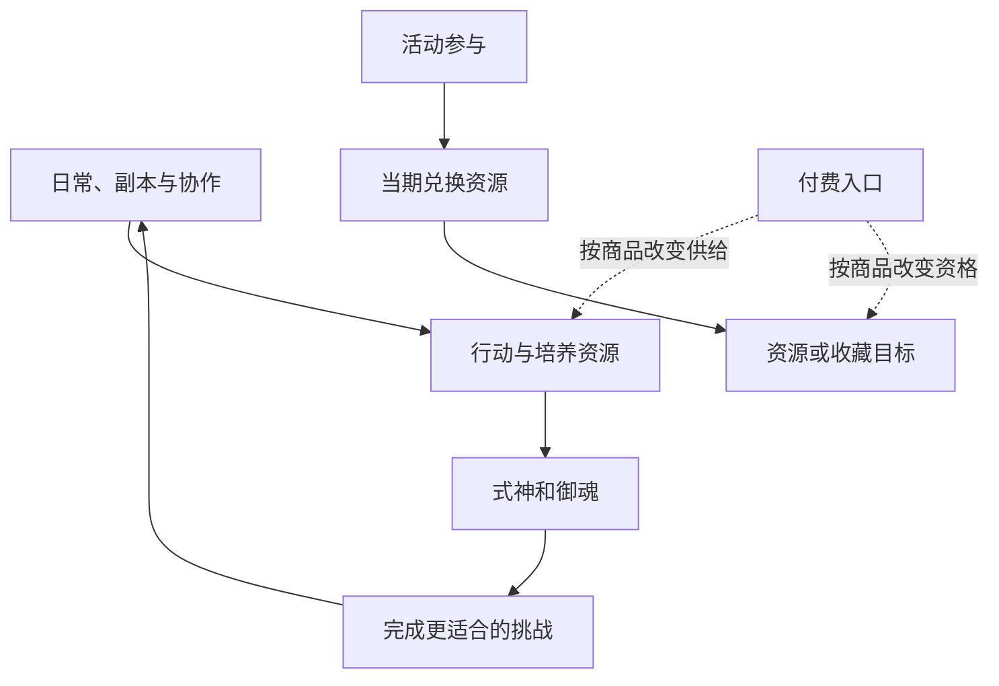

# 资源与商店：把今天的行动连接到长期目标

阴阳师 · 国服 App · 经济 / 资源分配

## 设计目的

资源系统决定玩家在多个成长目标之间如何选择。货币种类多不等于经济深；真正需要分析的是每种资源的来源、可替代性、消耗对象和时间限制。

## 资源框架

| 资源角色 | 例子 | 主要判断 |
|---|---|---|
| 行动预算 | 体力与特定玩法门票 | 今天参与什么，能否转移到别的目标 |
| 培养投入 | 金币、经验与各类材料 | 当前瓶颈在哪，培养谁 |
| 获取机会 | 勾玉、召唤符咒 | 现在使用还是为特定目标积累 |
| 模式兑换 | 荣誉、勋章及活动代币 | 哪些参与行为能换来目标奖励 |
| 付费入口 | 魂玉与礼包 | 花费改变了什么资源或资格 |

这是按用途作出的归纳，具体货币兑换率没有统一假设。入口关系参考[历史入门指南](https://www.taptap.cn/moment/15220000474270426)，限时资源例子见[维护公告](https://bbs.4399.cn/thread-view-tid-50384879)。

## 产出与消耗图



箭头表示用途，不表示固定比例；限时资源应单独追踪，不直接并入常驻收益。

## UI 与兑换流程

```ui-analysis
yy-economy
```

1. 选择目标，查看所需、已拥有与差额。

2. 对照获取途径和时间限制，决定投入哪类玩法。

3. 确认兑换对象、数量与消耗，避免只看折扣标记。

4. 取得结果并回到使用位置；失败时保留可解释状态。

## 数值设计与取舍

- **绑定来源能组织节奏。** 不同玩法提供不同资源，会让玩家接触更广内容；绑定太多则可能把自选目标变成强制日常。

- **过期资源需要提前解释。** 活动结束、兑换结束和清理时间可能不同，应各自显示。当前所有代币到期策略未核实。

- **效率评估应包含时间。** 一条路线的收益需连同准备、失败、整理和等待来计算，不能只比较掉落数量。

开发附录给出兑换事务切片。原作完整产消表、库存上限与实际通胀数据未取得，因此不宣称经济已经平衡或存在固定最优兑换顺序。

[养成](../systems/式神与阴阳师养成.md) · [活动商业化](../systems/活动与商业化.md)
