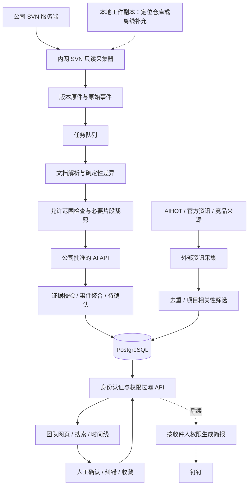

# Game Pulse · 游戏团队项目情报台

> 2026-10-23｜架构提案 v0.1｜工作名称待定
> 已确认：本轮先完成架构，暂不提供 SVN 路径；允许调用公司批准的外部 AI API。
> 本文为设计建议，未连接真实仓库、未运行采集任务、未部署服务。示例与性能目标不是实测结果。

## 1. 产品定位与取舍

团队每天花 3 分钟，回答四件事：项目改了什么、哪些变化与我有关、外部有什么值得参考、哪些方法现在就能用。

推荐定位为“项目事实 + 行业情报 + 可复用方法”的协作入口。首页以内部项目为主，外部新闻为辅；将已有 SVN、TAPD、钉钉、金山文档的信息串起来。任务状态继续由任务系统管理，正式文档继续在原位置维护。

第一版成功标准：成员无需逐个打开提交日志和文档，就能理解主要变化，并能点回证据核实。提交量、阅读量不用于个人绩效排名。

### 架构路线比较

| 路线 | 适用情况 | 代价与判断 |
| --- | --- | --- |
| 直接基于 AIHOT 全站改造 | 主要目标是行业资讯站 | 外部情报起步快；SVN、团队身份、目录权限、状态确认仍需新建，并审计全部公开出口 |
| 独立内部平台，接入 AIHOT API／RSS | 主要目标是游戏团队协作 | **推荐**。围绕项目数据设计，外部资讯先轻量接入；权限边界清晰 |
| 独立内部平台 + 内网自托管 AIHOT 资讯引擎 | 后期需要更多信源与自主筛选 | 可复用其资讯能力；多维护一套服务，达到需要时再引入 |

AIHOT 提供资讯处理、事件归组与简报能力；官方架构包含 web、api、worker 三类进程，且读者内容默认匿名。这是推荐独立项目域的重要依据。[官方架构](https://github.com/KKKKhazix/AIHOT/blob/main/docs/architecture.md)

若后续复用源码，应固定版本、保留许可证和声明、更换品牌；许可证和具体复用范围在实施时按对应版本确认。[开源仓库](https://github.com/KKKKhazix/AIHOT)

## 2. 页面与日常使用

建议导航：今日精选｜项目时间线｜系统专题｜竞品与行业｜AI 工作台；顶部全局搜索、项目切换、关注项，管理员单独进入采集与权限设置。

| 页面 | 内容与交互 | 解决的问题 |
| --- | --- | --- |
| 今日精选 | 自上次访问以来的重点变化、与我有关、待确认、少量外部参考 | 今天先看什么 |
| 项目时间线 | 按日期展示事件，可筛版本、分支、系统、作者、文档类型；展开到提交与文件 | 哪天发生了什么 |
| 系统专题 | 例如战斗、养成、经济、关卡；当前有效文档、最近变化、已确认决策、关联任务与竞品 | 一个系统现在是什么状态 |
| 竞品与行业 | 按关注游戏／品类聚合版本更新、机制、商业化、平台政策；说明适用条件 | 外部变化对项目有什么用 |
| AI 工作台 | 工具动态、方法卡、团队实验与已验证工作流 | 看完教程后怎么实际使用 |

首页布局建议：顶部项目与时间范围／同步状态；主体约 2/3 为内部精选，侧栏为待确认与关注系统；外部参考放独立区域，默认每天 3–5 条。窄屏按此优先级纵向排列。

每条项目卡片包含：一句话标题、3–5 条具体变化、关联系统、可能影响岗位、提交者、提交时间、版本号、证据入口、摘要状态。操作包括查看差异、关注系统、纠错，以及有权限的负责人确认。

**示意卡片，非真实项目数据：**

> 养成消耗表调整了前期材料曲线
> - 可验证事实：表格某行旧值 100 → 新值 80，附工作表、行键与单元格。
> - AI 推测：可能降低前期养成门槛，待数值负责人确认。
> - 当前状态：文档已更新；游戏内是否生效未知。
> - 证据：r1234、文件路径、两个修订版本、原始差异。

成员打开卡片记为“已读”；负责人确认表达“信息判断已确认”；“已开发／已测试／已上线”必须有任务、测试、构建或人工确认记录。四者不能自动互相转换。

## 3. 重点能力：把文件变化变成项目事件

### 内部变化与外部资讯使用两套规则

- **内部更新全部可查**：噪声只影响首页精选，不删除底层提交。按路径和内容规则识别策划、数值、程序、美术、测试等范围；日志过短不能作为丢弃依据。
- **内部优先级**：影响范围、规则／数值实质变化、当前里程碑、本人关注、是否待确认。负责人可置顶、改标签、纠错。
- **外部精选**：项目相关性、一手证据、可操作性、新颖性、时效性；转载数量只作辅助，避免把传播量当价值。
- **同一事件聚合**：同一系统的一组相关提交可合成事件，但保留各提交；大提交可拆成多个系统事件。人工合并／拆分不会被下一轮自动覆盖。

系统归属第一版用“目录映射 + 关键词 + 人工修订”，AI 补充建议；不同分支和项目不自动合并。作者表示提交者，责任人来自团队映射或手工指定。

### 文档理解要分层实现

| 类型 | 建议处理 | 清晰的边界 |
| --- | --- | --- |
| Markdown／TXT／JSON／CSV | 文本／结构差异，保留段落或字段定位 | 首批优先；处理编码差异，避免纯换行变化刷屏 |
| DOCX | 提取标题、段落、表格，前后版本结构对齐 | 区分文字、表格、样式变化；批注与修订的解释需要样本验证 |
| XLSX | 按工作表、稳定行键、列名比较；分别保存公式与缓存值 | 插行不能误判全部数据改变；公式改变不等于已重算，不运行宏 |
| PDF | 提取页码与段落；扫描件另走 OCR | 阅读顺序与 OCR 不可靠时标记“需人工查看”，不伪造完整差异 |
| 图片／设计资源 | 缩略图与版本并排；视觉描述为可选增强 | 不根据图片描述判断实际玩法或资源已接入 |
| DOC／XLS／加密文件／不支持格式 | 保留元数据与文件更新记录；以后增加隔离转换 | 解析失败可重试，不阻塞其他文件，不显示“无变化” |

格式支持顺序最终由真实样本决定。如果团队以 DOCX／XLSX 为主，就将其纳入首个可用版本；无需为了先做简单格式而延迟核心价值。

摘要先做确定性的数字／字段比较，再由模型解释含义。默认只发送变更片段及必要上下文，避免把整份巨型表格直接塞入模型。每个结论引用版本、路径和段落／表格位置；找不到证据时显示“仅有提交说明”或“影响待确认”。

## 4. 总体架构

推荐早期使用模块化单体：一套代码库，Web/API、后台 Worker、SVN 采集器分别运行。模块逻辑隔离，暂不引入大量独立微服务。

### 建议技术组合

| 层 | 推荐 | 原因 |
| --- | --- | --- |
| Web | React + TypeScript + Vite | 团队内部应用无需优先追求搜索引擎收录；组件化适合列表、筛选和差异页 |
| API | Node.js + TypeScript + Fastify | 与前端共享类型；项目、事件、权限、资讯各自模块化 |
| 后台任务 | 独立 Worker + PostgreSQL 任务队列，如 pg-boss | 异步摘要、重试与定时采集；早期省去额外 Redis 服务 |
| SVN 采集器 | Node.js 调用官方 SVN CLI，使用参数数组启动进程 | 复用成熟 SVN 客户端，不直接解析 .svn 内部数据库 |
| 文档解析 | 首期按样本选库；复杂 Office／PDF 增加隔离的 Python 解析进程 | 控制超时、内存与文件大小；不执行文档宏或内嵌脚本 |
| 业务存储 | PostgreSQL | 关系、状态、审计和任务队列统一维护 |
| 文件存储 | 内网磁盘卷起步；规模增长后迁移 S3 兼容存储 | 原件、预览、解析中间结果按内容哈希复用 |
| 搜索 | 标题、标签、文件路径、文档正文检索先行 | 中文分词单独验证；后续根据质量引入向量检索与 pgvector |
| 模型接入 | 公司批准模型的统一适配层 | 可替换供应商；支持结构化结果、版本记录、超时、预算限制 |
| 身份与权限 | MVP 管理员配置成员和项目角色；后续公司 SSO／钉钉登录 | 身份与 SVN 路径授权明确映射，避免默认全员可见 |
| 部署 | 内网常驻主机；具备 Linux/Docker 运维能力时用 Compose | 集中运行与备份，用户浏览器无需安装插件 |

依赖的具体版本在实现时固定并验证，不以本提案代替兼容性测试。AIHOT 自身使用 PostgreSQL、React、Fastify 和后台队列，说明其模块方式有可参考实现；上述组合仍是本项目的设计选择。[架构](https://github.com/KKKKhazix/AIHOT/blob/main/docs/architecture.md)／[部署配置](https://github.com/KKKKhazix/AIHOT/blob/main/docker-compose.yml)

## 5. SVN 如何持续读取

普通网页可经用户选择获得部分本地文件访问能力，但这不等同于可关闭浏览器后持续运行的 SVN 采集服务。因此推荐使用常驻采集器。[浏览器文件访问说明](https://developer.mozilla.org/en-US/docs/Web/API/File_System_API)

### 三种数据条件

1. **能连接 SVN 服务端：推荐。** 从用户给出的工作副本通过 `svn info --xml` 获得仓库身份与地址，之后用专用只读账号对服务端查询；不用等个人电脑执行 update 才知道最新提交。
2. **只能访问本地工作副本，且无法连接服务端。** 只能记录已同步文件的状态与后续本地快照；未同步更新和完整历史不能保证，必须显示“本地快照／最近同步时间”。这不是全团队实时更新。
3. **拿到服务端 post-commit 配置权限。** 后期可由钩子发送轻量修订通知，Worker 再取数；保留周期补查，漏通知可恢复，AI 任务不阻塞 SVN 提交。

### 推荐增量过程

1. 维护仓库 UUID、项目根路径、包含／排除目录、采集身份、授权范围与上次扫描水位。只取配置范围，跳过构建产物、缓存和不必要的大资源。
2. 首次读取目标路径当前有效文档作为基线，历史默认回填近 30 天并标记“历史导入”。基线分批限额；不把历史导入当今日新增推送。
3. 每 60–120 秒查询一次服务端，固定本轮观察到的 HEAD 为结束修订；通过 `svn log --xml -v -r start:end` 获取范围记录。不能用未更新工作副本的默认 BASE 代表远端最新状态。
4. 原始记录先落库，再安排文件提取／解析；采集水位只在查询区间完整持久化后推进。全库修订号可能跳过不属于本项目的更新，不能要求项目内每个修订号连续。
5. 每个文件从服务端提取明确版本；普通修改比较 r-1 与 r，新增／删除分别保存存在的一侧。移动／复制跟踪 copy-from 和 peg revision；替换、目录复制、外部引用分别建规则，禁止假设每条变更只是同路径修改。
6. 使用 `(repository_uuid, revision, path, change_kind)` 标识原始变化；内容哈希与解析器版本决定是否复用解析，摘要另含模型和提示词版本。重复轮询、重启与重试不产生重复事件。
7. 原始采集进度与解析／摘要进度分开；单个坏文件进入失败队列，列表先显示事实，摘要稍后补齐。断网按上次水位补采，认证失败明确显示。
8. 存储提交时间、首次发现时间、处理时间，展示用团队时区；首页持续显示最近成功扫描时间、积压数量和错误状态。

`svn log` 可返回日志与变更路径，`svn diff` 可指定版本比较；实际客户端行为需要用将来安装的版本验证。[SVN log](https://svnbook.red-bean.com/en/1.8/svn.ref.svn.c.log.html)／[SVN diff](https://svnbook.red-bean.com/en/1.8/svn.ref.svn.c.diff.html)

默认不自动 `svn update` 用户工作副本，不采集未提交草稿，不做 `commit`。将来如需本地草稿，必须成为独立可见范围和明确状态。

## 6. AI 摘要、权限与可信度

### 数据出站与模型处理

已允许公司批准的外部 API。管理员配置供应商白名单、项目／目录允许范围、每日预算和单文档上限；原始二进制文件留在内网，模型请求只含被允许的文本或结构化差异。敏感字段按规则去除；需要图像理解时单独配置允许范围。

外部新闻与内部项目采用独立提示词、任务类型和存储标识；不把内部设计文本作为公网搜索查询。新闻和文档正文只视为待分析数据，模型不能因正文中的指令执行命令或访问额外文件。

生成结果结构建议：`summary`、`facts[]`、`inferences[]`、`evidence_refs[]`、`affected_systems[]`、`review_state`。数字由差异数据校验；引用必须落到已提取版本；校验失败保留原始记录并转为待人工查看。

AI 推断使用“可能影响／待确认”措辞；不展示未经校准的“98% 准确”分数。人工确认保存确认人、时间、覆盖范围。修订摘要保留历史与纠错原因，新模型不能静默覆盖已确认结果。

### 权限必须覆盖衍生内容

- 角色最少包括管理员、编辑／负责人、阅读者；项目成员之外默认拒绝。
- 采集器有权读取，不代表所有网页用户有权看。首版可限定为权限一致的一个项目团队；如果仓库包含隔离目录，则先排除或建立可信的目录授权映射后再索引。
- 聚合摘要的权限按全部引用证据收紧；用户无法访问其中某项证据时，不展示可能泄露该项内容的混合摘要，可重新生成仅包含有权内容的视图。
- 权限校验适用于列表计数、搜索结果、自动补全、预览、下载、历史摘要、简报与模型问答；不能只隐藏网页按钮。
- 撤销权限要失效缓存与后续简报；跨用户缓存必须包含授权范围。SVN 路径权限变化的同步方式在接入时确定，不能假设只读账号等于全员授权。
- 内部资料不进入匿名 API、RSS、MCP、站点地图或公开分享图；可公开的外部资讯也不要和内部数据混合导出。

## 7. 数据结构与接口边界

| 对象 | 关键内容 |
| --- | --- |
| Project / Repository / Branch | 项目、仓库身份、监控范围、分支与时区 |
| Membership / AccessPolicy | 成员、角色、路径规则、授权版本 |
| Revision / FileChange | 作者、提交时间、原始说明、路径、变更类型、copy-from |
| DocumentVersion / Evidence | 文件哈希、版本、解析器版本、段落／表格／页码定位、权限来源 |
| ProjectEvent | 多个提交形成的事件、系统、版本、精选状态、证据集合 |
| Summary / Review | 模型／提示词版本、事实、推测、人工确认与纠错历史 |
| SystemTopic / Decision | 系统当前有效文档指针、明确决策、关联任务、更新时间 |
| ExternalItem / ExternalEvent | 原始链接、来源、发布时间、发现时间、去重与相关性理由 |
| Workflow / Experiment | 方法步骤、输入输出、适用条件、实验记录与验证状态 |
| Subscription / ReadState / Digest | 个人关注、已读位置、按权限生成的简报 |
| Job / ModelCall / SyncCursor / Audit | 重试、调用成本、扫描水位与操作记录 |

数据库初期可同库分表；每个内部对象必须有项目归属，任何搜索与聚合先做权限约束。内容哈希相同不代表访问权限相同。

内部 API 轮廓：

- `GET /api/projects/:id/feed`：精选与“自上次访问以来”；游标分页。
- `GET /api/projects/:id/timeline`：日期、系统、作者、分支、版本筛选。
- `GET /api/events/:id` 与 `/evidence`：摘要、原始提交和可访问证据。
- `GET /api/documents/:id/compare?from=...&to=...`：两个明确版本的差异。
- `POST /api/events/:id/reviews`：确认、纠错、待核实；权限与审计必需。
- `GET /api/search`、`/api/external/feed`、`/api/workflows`：对应阅读入口。
- `GET /api/admin/sync-status`：扫描水位、队列积压、失败文件与模型预算。

页面只读已生成结果，打开首页不现场等待模型。新内容提醒可用 SSE，断线时降级为定期刷新；这影响页面显示延迟，不代替后端采集。

## 8. 外部情报与 AI 工作流如何产生价值

先建立“项目画像”：游戏品类、目标平台、开发阶段、当前难题、关注竞品、技术栈及岗位关注项。推荐理由应能映射到这些字段，例如“适合评估你们正在调整的关卡生成流程”，缺少项目资料时明确为通用推荐。

| 栏目 | 候选来源方向 | 每条内容必须回答 |
| --- | --- | --- |
| 竞品 | 已选竞品官网、官方版本公告、商店更新记录 | 改了哪个机制？证据是什么？与当前项目有何关联？ |
| 游戏行业 | 平台／引擎官方发布，可信行业媒体作补充 | 哪类项目受影响？生效时间和适用范围是什么？ |
| AI 开发动态 | AIHOT、工具官方文档、代码仓库 release | 改进哪一步？需要什么环境？是否只是演示？ |
| 团队方法 | 经过试验的内部操作记录、外部教程转化 | 谁能复现？投入多少？产物怎样验收？ |

第一期 AIHOT 可作为补充来源，使用 `/api/v1`，缓存 ETag 并按官方节奏请求；若要完整精选同步，应处理新增、修改和撤选。网站当前说明旧 `/api/public/*` 在 2026-10-31 停用，接入时不要使用旧端点。[官方 API 接入](https://aihot.news/agent?tab=api)

AIHOT 聚焦 AI 信息，不能覆盖全部游戏竞品。每个新来源必须记录可用抓取方式、频率和显示范围；默认展示短摘要、来源与原文链接。获取失败显示来源过期，不能继续冒充“最新”。

推荐链路：资讯 → 收藏到某系统 → 标记值得试验 → 指定负责人／关联 TAPD → 记录试验结果 → 形成可复用方法卡。只有明确操作才创建外部任务或发消息。

**方法卡模板**：要解决的问题；适用引擎／版本；前置条件；示例输入；操作步骤与提示词；预期产物；人工检查点；失败情形；工具与耗时成本；最近验证日期；负责人；来源；状态（收集／试验／团队验证／过期）。

起步可收录的主题：策划文档转验收清单、数值表检查、代码辅助与评审、美术素材一致性、关卡生成与求解验证、构建回归与版本说明。它们是内容规划，不代表已替团队验证。

## 9. 协作闭环与后续集成

现有工具背景为钉钉、TAPD、金山文档。优先提供原始链接和人工关联，减少重复录入；实际连接方式与权限需届时验证。

- **钉钉**：后续加入订阅摘要或晨报；默认日汇总，重要变更按关注发送，避免每个提交都刷群。收件群的成员权限需覆盖内容权限，否则只发无敏感标题的登录入口。
- **TAPD**：将项目事件挂到需求／缺陷；状态以任务系统或负责人为准，不凭提交说明自动完成任务。
- **金山文档**：将在线文档作为额外来源接入同一证据体系，不能以浏览器链接存在推断可采集全部历史。
- **系统专题**：支持“这条规则为何这样改”的决策记录，区分正式决策与 AI 的推理。
- **项目问答**：第二阶段再做带引用检索问答；检索前过滤权限，回答展示时间范围和来源，证据不足时明确回答未知。

## 10. 部署、运行与成本

推荐团队正式使用时放在可访问 SVN 的公司常驻主机，网页通过内网或公司 VPN 访问。采集器可独立运行在 Windows 主机，应用与数据库可在内网 Linux 主机；机器选择按现有运维条件决定。

个人电脑可以做验证，但关机／睡眠后无法保证采集。若以后选择云端前端，也必须有内网采集器和受控 HTTPS 出站通道；“把网页部署出去”本身不会赋予读取本地 SVN 的能力。

初期不指定固定服务器价格或硬件保证。用真实 30 天更新量、最大文档、并发人数及保留期估算：模型费用≈新变更数量×平均处理 token×单价；解析、OCR、原件保留与备份另算。后台展示实际 token、费用和耗时。

运行必须具备：失败重试与隔离、预算阈值、幂等处理、磁盘容量告警、数据库与文件一致性备份、恢复演练、采集身份失效提示。模型不可用时继续显示提交事实和已生成摘要。

模型请求保留幂等键和结果回执；网络超时导致结果未知时，不承诺绝对不会重复计费，应记录并按供应商能力核查或人工重试。

## 11. 分阶段实施与验收

### M0：用真实样本验证信息是否可信

输入：一个授权项目范围，30 天以内提交，10–20 个代表性文档，包含真实主要格式；确认账号、目录权限、模型白名单和机器条件。

产出：目录分类表、解析支持矩阵、若干变更卡片和明确证据、运行成本样本。退出标准：用户能辨认“这次到底改了什么”，确定是否需要增强 Office 解析；此时再估工期。

### M1：内部团队可用版本

单项目／明确分支范围、SVN 增量采集、主要文档差异、精选与全量时间线、事件详情、系统分类、基础搜索、成员权限、人工纠错、采集状态页。首页可配置 AIHOT 轻量摘要区；竞品先以人工加入链接起步。

### M2：情报与协作闭环

竞品监控、项目画像推荐、系统专题、个人关注与跨设备已读、方法卡、试验记录、钉钉简报及 TAPD 关联。

### M3：进一步智能化

有引用的项目问答、跨文档冲突候选、需求到测试链路、多项目与跨版本分析；只有证据与权限基础稳定后再投入。

### 第一版必须通过的验收

1. 新提交能从真实 SVN 进入网页。普通负载下，事实记录目标 2 分钟内出现、常规文档摘要目标 5 分钟内完成；这是待样本验证的目标，大文件显示排队状态。
2. 断网、重启、重复轮询后不丢记录、不重复卡片；多次修订与跨分支记录归属正确。
3. 新增、修改、删除、复制／移动、目录变化、二进制、解析失败均有明确状态；权限错误不得表现为“没有更新”。
4. 每条核心结论均能打开对应版本和原文位置；抽查数字与原件一致，无法提取时明确降级。
5. 权限不同的两名用户在页面、搜索、摘要、预览、下载和简报中不能看到越权内容；权限收回后缓存失效。
6. 未提交本地文件不会进入团队信息流；采集器不修改用户工作副本。
7. “已提交”“负责人确认”“已上线”状态不会混用；人工纠错和置顶在重算后保留。
8. 外部资讯保留来源与日期、同事件转载可合并、撤选能同步；旧闻回填不会变成今日热点。
9. AI 超时或预算耗尽时提交事实仍可阅读；模型调用与失败原因可查，恢复后可补摘要。
10. 至少完成一次数据库与文件联合恢复演练；以真实团队网络检验页面读取速度，再订性能目标。

暂不纳入第一版：编辑 SVN 文档、全量历史重建、完整任务管理、自动执行工作流、自动改游戏代码、人员绩效评分、对外公开门户。

## 12. 下一步所需信息

本轮架构不依赖下列信息，进入 M0 时再提供：SVN 工作副本或服务端路径、允许读取的目录、主要文档样本、团队规模和权限差异、常驻主机条件、批准的模型 API、关注竞品与项目品类。

推荐下一步从“一条真实提交 → 可验证差异 → 一张精选卡片 → 时间线”做完整纵向验证，再扩展新闻和工作流。这样先验证最重要的数据质量，也能避免早期花大量时间做界面而不了解文档能否准确解析。
